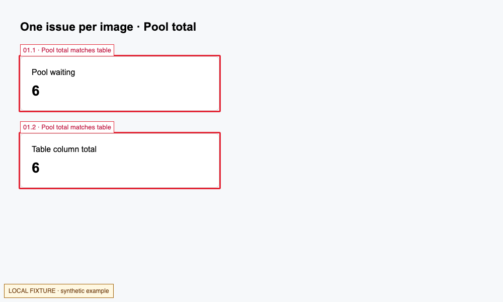

# redbox-review：红框逐项说明

让 coding agent 在真实网页截图中圈出问题，**一张图只解释一个独立改动**，并说明原行为、错误证据、目标行为和已有 MR/PR 的覆盖范围。

适合页面评审、统计口径对账、缺陷定位与修改范围确认。它是普通 Skill，不是浏览器插件；无需项目专属账号、内网服务或 MCP。



## 安装与调用

克隆本仓，再把**整个目录**复制到宿主支持的技能目录，或让宿主的技能安装器安装本仓。已有同名技能时先比较内容，再决定更新，不直接覆盖。

```sh
git clone https://github.com/ratio-dd/redbox-review.git
```

常见落点：

| 宿主 | 项目级目录 | 用户级目录 |
| --- | --- | --- |
| Codex | `.agents/skills/redbox-review/` | `$CODEX_HOME/skills/redbox-review/`，未设置时为 `~/.codex/skills/redbox-review/` |
| Claude Code | `.claude/skills/redbox-review/` | `~/.claude/skills/redbox-review/` |

安装后按宿主要求重新加载。Skill 本身不绑定某个浏览器工具；宿主应具备截图能力。附带的可选 Node 辅助函数适用于 Playwright。

调用示例：

> 使用 $redbox-review，本地截图圈出需要改的位置。每张图只说明一个问题，讲清原口径、哪里不对、明确错误还是可能错误、准备改成什么。先核对已有 PR，避免重复修改。

只希望标位置时可直接说“截图圈出来”，不必额外进行业务审计。使用规则见 [SKILL.md](SKILL.md)。

## 输出形式

每项包含一张标注图，以及：

- **原口径 / 原行为**：当前实现是什么。
- **哪里不对**：具体反例或已确认的需求冲突。
- **判断**：明确错误、条件性错误或尚待确认。
- **改成什么**：拟采用的公式或行为。
- **是否还要改**：已有 MR/PR 覆盖程度及剩余工作。

同一问题的两个对账位置可以同时圈选；后端计算、页面值、Tooltip 和校验是同一改动的连带位置。只有回归需要的区域不单独当成缺陷圈红。

## Playwright 辅助函数

`captureRedbox(page, options)` 使用调用方已经创建的任务页面；不启动浏览器、不访问业务 API，也不负责登录。

```js
import path from 'node:path';
import { captureRedbox } from './scripts/capture-redbox.mjs';

await captureRedbox(page, {
  outputDir: path.resolve('output/redbox-review'),
  name: '01-pool-total',
  issue: '01',
  title: 'Pool 与整表合计对账',
  targets: [page.getByTestId('pool-total'), page.getByTestId('pool-column')],
  source: '本地模拟数据',
  revision: 'feature-branch / commit-sha',
});
```

| 参数 | 含义 |
| --- | --- |
| `outputDir` | 输出目录绝对路径 |
| `name` | 文件名前缀，只含字母、数字、连字符和下划线 |
| `issue` / `title` | 单个问题编号与简短红框标题 |
| `targets` | 一个或多个 Locator，每个必须唯一且完整位于当前视口内 |
| `source` | 数据来源，例如本地模拟数据、测试环境 |
| `revision` | 可选，代码版本标识 |

会生成 `*-raw.png`、`*-marked.png`、`*-evidence.json`。已有同名文件会拒绝覆盖，目标移动或不完整可见时会失败；请等待稳定、调整视口并使用新名称重试。只截当前视口；长页面按问题滚动后分别截图，不自动拼接或裁剪。

红框通过临时 Shadow DOM 绘制，截图后清理；数值与业务 DOM 保持原样。标签过长会折行，仍需人工检查是否遮挡。证据 URL 默认去掉认证信息、查询参数及路由查询参数，文件清单仅记录文件名；截图与路径中的业务标识仍需发布前检查。

## 本地验证与示例

Node.js 20+，测试和演示在克隆的源码仓库中运行；只安装了运行文件时先克隆源码。只在运行辅助函数测试或演示时需要安装 Playwright 开发依赖：

```sh
npm ci
npx playwright install chromium
npm test
npm run demo
```

测试和演示使用任务独立 Chromium 与合成 HTML，不连接真实业务系统，不复用个人浏览器。演示输出保存在 `output/demo/`；截图应由人查看，不将“成功截图”当作业务统计正确的证明。

演示源码见 [examples/demo.mjs](examples/demo.mjs)，可复现测试见 [tests/capture-redbox.test.mjs](https://github.com/ratio-dd/redbox-review/blob/main/tests/capture-redbox.test.mjs)。MIT 许可证见 [LICENSE](LICENSE)。
